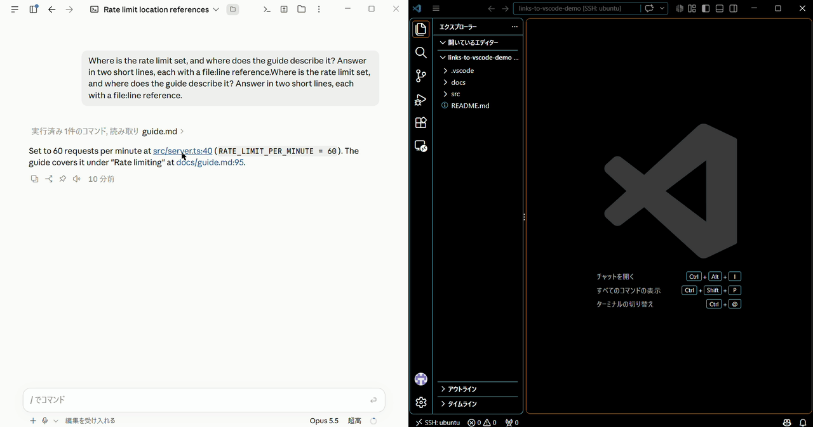

# claude-desktop-links-to-vscode-mod

A [Claude Code mod](https://code.claude.com/docs/en/plugins/mods/overview) for the desktop app.
**Click a file reference in a reply, and the file opens in VS Code at that line.**



In the desktop app's Code tab, a reply cites files as links such as `src/server.ts:42`. A click opens the app's own file pane, and an SSH session offers no "Open in" entry for your editor. With this mod, the click goes to the VS Code window you already have open.

- **Remote-SSH**: the file opens in the window whose folder contains it.
- **Local**: on macOS and Linux, through the `code` command.
- **Markdown Preview**: a previewed Markdown file scrolls to the line and stays a preview.
- Web links, images, folders and paths that do not exist behave as before.

[日本語](README.ja.md) · [How it works](docs/how-it-works.md)

## Install

You need the desktop app's Code tab with Claude Code v2.1.287 or later, VS Code 1.90 or later, and `bash`.
Run these on the machine where the session runs. For an SSH session, that is the remote host.

1. Install the plugin. In a session:

   ```text
   /plugin install open-in-vscode --marketplace gggg5151/claude-desktop-links-to-vscode-mod
   ```

   Or in your shell:

   ```bash
   claude plugin marketplace add gggg5151/claude-desktop-links-to-vscode-mod
   claude plugin install open-in-vscode@links-to-vscode
   ```

2. Start a new session and click a file reference.

3. For the Markdown Preview jump, install the bundled VS Code extension. In a session, while a VS Code window is open:

   ```text
   /open-in-vscode-install-extension
   ```

To load a clone instead of installing, see [How it works](docs/how-it-works.md#load-from-a-clone). A mod runs with your permissions; `claude plugin validate <folder>` lists what this one hooks and calls, without running it.

## Known limitations

- Windows is not supported as the machine the session runs on.
- Any readable file can be opened, `.env` included. Mind it while sharing your screen.
- When VS Code cannot be reached, the click shows a notice and the app's file pane does not open.
- With several Remote-SSH windows, a folder whose path has spaces, non-ASCII characters or `+` may not be matched. The newest window is used.
- The Markdown Preview jump shows a text tab for a moment.
- Choosing the window relies on VS Code internals, so a VS Code update can break it.

The full list is in [How it works](docs/how-it-works.md#limits).

## License

[MIT](LICENSE)
